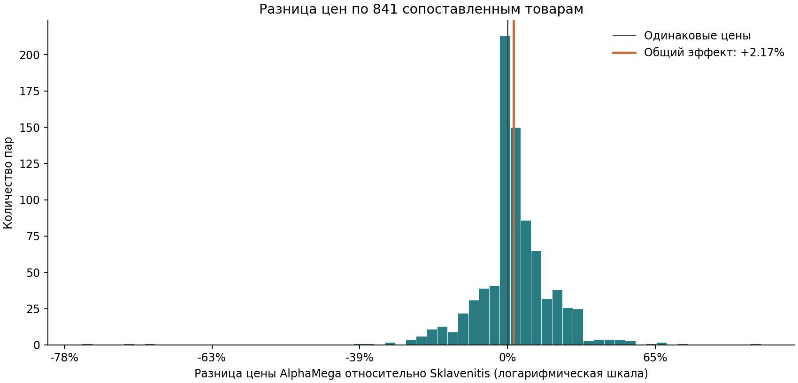
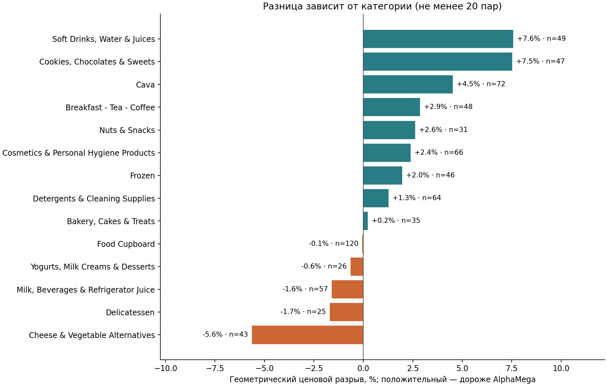
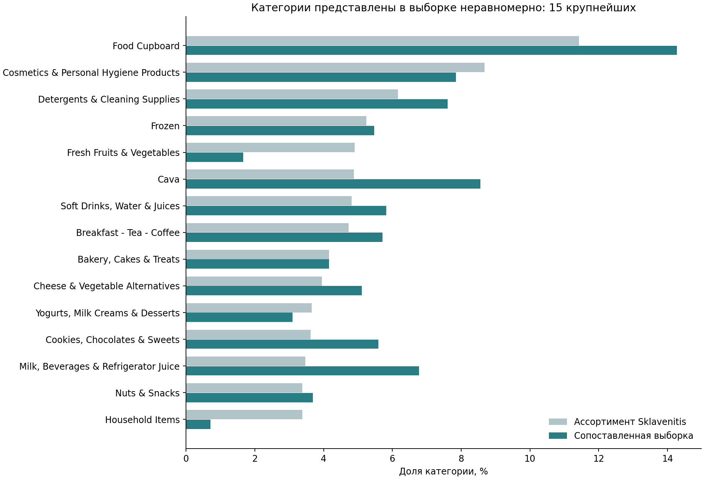

# Сравнение цен супермаркетов на Кипре: сопоставление товаров и статистический анализ

Когда я была на Кипре, мне стало интересно, какой из двух популярных супермаркетов — **Sklavenitis или AlphaMega — дороже**.
Простое сравнение средних цен не подходит: ассортимент магазинов различается. Поэтому сначала я сопоставила одинаковые или признанные сопоставимыми после проверки товары, а затем проверила разницу их цен.

**Основной результат:** в выборке из **841 товарной пары** геометрическое среднее отношения цен AlphaMega к Sklavenitis составляет **1,0217**, то есть ценовой разрыв — **+2,17%**. Bootstrap 95% доверительный интервал: **от +1,13% до +3,16%**. Вывод относится к сопоставленной выборке в выбранных онлайн-каналах на дату сбора, а не автоматически ко всему ассортименту.

**Стек:** Python · pandas · NumPy · Jupyter Notebook · scikit-learn · SciPy · statsmodels · Matplotlib. Excel использовался для ручной разметки и проверки кандидатов.

## Цель исследования

Проверить, есть ли систематическое различие цен на сопоставимые товары, оценить его величину и посмотреть, как разница распределяется по категориям.

Это наблюдательное исследование. Оно не является A/B-тестом, оценкой причинного эффекта или стоимости типичной покупательской корзины.

## Данные

Срез на **13 марта 2026 года**, Лимасол, Кипр:

| Источник каталога | Товарных позиций |
|---|---:|
| Sklavenitis Ypsonas — каталог Wolt | 3 342 |
| AlphaMega — сайт магазина | 8 672 |
| Всего | **12 014** |

Данные собраны мной из открытых онлайн-каталогов. Поля включают название, категорию, цену, акционную цену, фасовку, ссылки на карточку/изображение и время сбора. Бренд в исходной выгрузке не всегда надёжен. Наименования, единицы измерения и структура категорий различаются.

В репозитории сохранены обработанные таблицы, ручные словари, **882 размеченные пары для ML** и **841 итоговая пара**. Для повторения основного анализа исходные выгрузки не нужны. Источники и описание файлов: [данные](docs/DATA.md).

## Методология

1. **Подготовка данных.** Очистила названия, убрала служебные фрагменты и лишние пробелы, извлекла вес, объём, количество единиц и дополнительные характеристики. Привела единицы измерения к общему виду.
2. **Нормализация.** Вручную разметила 500 строк для построения словарей брендов и типов товаров. Дополняла словари по нераспознанным случаям; для неоднозначных правил учитывала категорию.
3. **Сопоставление товаров.** Отбирала кандидатов по нескольким правилам: бренд, тип, фасовка, общие информативные слова. Дополнительные правила TF-IDF помогали находить пары при пропусках и разном написании. Получилось **53 436 пар-кандидатов**.
4. **Скоринг.** Для каждой пары рассчитала TF-IDF сходство по словам и символам, fuzzy similarity через `difflib.SequenceMatcher`, сходство бренда, типа и фасовки. Объединила признаки взвешенной формулой с поправками за различия характеристик. Скоринг — оценка сходства, а не вероятность.
5. **ML-эксперименты.** Сравнила Logistic Regression, Random Forest и HistGradientBoosting на 882 размеченных парах. Использовала 5-fold кросс-валидацию с группировкой по товару Sklavenitis. Проверяла precision, recall, F1 и ROC-AUC; порог выбирала при precision ≥95%.
6. **Ручная валидация.** Итоговая разметка объединяет ручные метки, принятые ML-совпадения и последующую проверку по скорингу. Спорные пары и дубликаты проверяла по карточкам и изображениям. В итоговом наборе каждому товару соответствует один товар другого магазина.
7. **Статистический анализ.** На 841 паре проверила средний логарифм отношения цен против нуля, дополнительно применила Wilcoxon signed-rank и sign test. Построила парный bootstrap-интервал: 10 000 повторений, seed = 13. Отдельно описала различия по категориям и проверила устойчивость результата на совпадающих извлечённых фасовках.

### Как рассчитывается ценовой разрыв

Цена товара — акционная, если она указана, иначе обычная. В основной метрике используется цена упаковки/товарной позиции, без пересчёта на кг или литр.

```text
ratio_i = price_AlphaMega_i / price_Sklavenitis_i
log_ratio_i = ln(ratio_i)
geometric_ratio = exp(mean(log_ratio_i))
price_gap_percent = (geometric_ratio − 1) × 100
```

Логарифм позволяет симметрично учитывать рост и снижение отношения цен. Каждая товарная пара имеет одинаковый вес. **+2,17% — геометрический эффект**, а обычное среднее процентных различий равно +3,20%; это разные способы обобщить данные.

### Что дала попытка использовать ML

В историческом эксперименте выбирался Random Forest при пороге **0,75**: precision **96,22%**, recall **75,92%**. При ручной проверке новых кандидатов взвешенный скоринг оказался для меня полезнее и понятнее для дальнейшего ранжирования: снижение оценки лучше отражало ухудшение совпадений.

Это наблюдение по ручной проверке, а не количественное доказательство превосходства скоринга над ML. Почти сбалансированная размеченная выборка отличается от всего пула кандидатов; её precision нельзя автоматически переносить на неразмеченные пары.

Первоначальные версии библиотек не были зафиксированы. В повторном запуске в окружении из `requirements.txt` по тому же правилу выбирается **Logistic Regression, порог 0,70: precision 95,22%, recall 77,75%**. Исторические метрики сохранены отдельно; причина расхождения точно не установлена. Сравнение доступно в [ноутбуке ML](notebooks/03_ml_experiments.ipynb) и [таблице повторного запуска](reports/tables/ml_reproduction_comparison.csv).

## Результаты

Числа пересчитаны из сохранённых цен; машиночитаемый результат — [reports/metrics.json](reports/metrics.json).

| Показатель | Значение |
|---|---:|
| Итоговых товарных пар | **841** |
| Геометрическое среднее отношения цен AM / SK | **1,0217** |
| Геометрический ценовой разрыв | **+2,17%** |
| 95% bootstrap CI для этого эффекта | **[+1,13%; +3,16%]** |
| Медианное процентное различие | **+1,34%** |
| Обычное среднее процентных различий | **+3,20%** |
| p-value t-теста логарифмов отношений | **0,0000302** |
| AlphaMega дороже / Sklavenitis дороже / одинаково | **514 / 242 / 85** |

Средний логарифм отношения цен статистически значимо отличается от нуля. Дополнительные тесты согласуются с направлением эффекта. Среди **756 пар с разной ценой** AlphaMega дороже в **67,99%** случаев.



### Различия по категориям

Для графика оставлены категории с не менее чем 20 парами. Положительное значение означает более высокие цены AlphaMega. Это описательный анализ: отдельные тесты значимости по категориям не проводились.



Наибольший положительный разрыв среди этих категорий наблюдается у напитков и сладостей. В некоторых молочных и смежных категориях направление обратное. Общая оценка не означает одинаковую разницу для каждого товара и каждой категории.

## Выводы и ограничения

- **Выборка не случайная.** Сопоставлено 25,16% загруженного ассортимента Sklavenitis и 9,70% AlphaMega. В неё чаще попадают товары с общим аналогом, которые удалось распознать. Представительность для всего ассортимента не подтверждена.
- **Разные источники цен.** Sklavenitis представлен каталогом Wolt, AlphaMega — сайтом магазина. Возможное влияние онлайн-канала не отделено от различий магазинов; цены в физических магазинах могли отличаться.
- **Фасовки проверялись.** У 818 пар заполненные извлечённые фасовки совпадают. Ещё у двух пар оба значения пустые, поэтому автоматический флаг также равен True. Остальные 21 пару я проверила вручную и признала сопоставимой: небольшие различия, пропуски или возможные ошибки названий. Если различие объёма реально, оно влияет на сравнение цены упаковки. Дополнительный анализ только 818 пар дал **+1,90%, p = 0,000189**; это проверка устойчивости, а не отмена ручных решений.
- **Одна дата и акции.** Результат описывает срез, а не устойчивую во времени ценовую политику. У 67 товаров AlphaMega использована указанная акционная цена.
- **Нет весов покупательской корзины.** Редко покупаемый товар влияет на результат так же, как часто покупаемый. Вывод не равен ожидаемой экономии покупателя.
- **Есть неопределённость сопоставления.** Ошибки карточек, извлечения признаков и принятые ML-совпадения могут влиять на итог. Независимая оценка точности всех 841 пар не проводилась.
- **Интервалы не устраняют смещение отбора.** Bootstrap пересобирает уже выбранные пары; зависимость цен внутри брендов и категорий отдельно не моделировалась.



**Практический вывод:** в исследованной выборке AlphaMega имеет более высокий геометрический уровень цен, но для выбора конкретной покупки важны товар, категория и действующая акция.

## Структура проекта

```text
notebooks/              01 — подготовка; 02 — matching; 03 — ML; 04 — статистика
scripts/                код подготовки, сопоставления, ML и анализа
data/processed/         проверенные снимки двух каталогов и 841 итоговая пара
data/reference/         ручная разметка, словари и исторические ML-метрики
data/raw/               необязательные локальные исходники, исключены из Git
data/interim/           промежуточные результаты повторного запуска, исключены из Git
reports/figures/         графики для README
reports/tables/          итоговые таблицы и проверки воспроизводимости
docs/                   данные, методология, запуск и аудит публикации
archive/                рабочие ноутбуки и исторические скрипты для контекста
```

## Как запустить

Проверено на **Python 3.12**. Команды выполняются из корня проекта; `python --version` должен показывать 3.12.x.

```bash
python -m venv .venv
```

Активировать окружение: Windows PowerShell — `.venv\Scripts\Activate.ps1`; macOS/Linux — `source .venv/bin/activate`.

```bash
python -m pip install -r requirements.txt
python scripts/analyze_prices.py
python scripts/ml_experiments.py
python scripts/validate_project.py
python -m jupyterlab
```

Для первого знакомства открой [04_price_analysis.ipynb](notebooks/04_price_analysis.ipynb). Для полного просмотра метода читай ноутбуки 01 → 04. Все четыре выполняются независимо от сохранённого состояния ядра; ноутбук 02 заново строит кандидатов и может работать дольше остальных.

Основной анализ и ML запускаются с включёнными CSV, без запросов к сайтам. Исходный сбор и ручная разметка не автоматизированы в этом репозитории. Подробные инструкции, ограничения raw-этапа и проверенное окружение: [воспроизводимость](docs/REPRODUCIBILITY.md). Результаты аудита и безопасная публикация: [аудит](docs/AUDIT.md).
